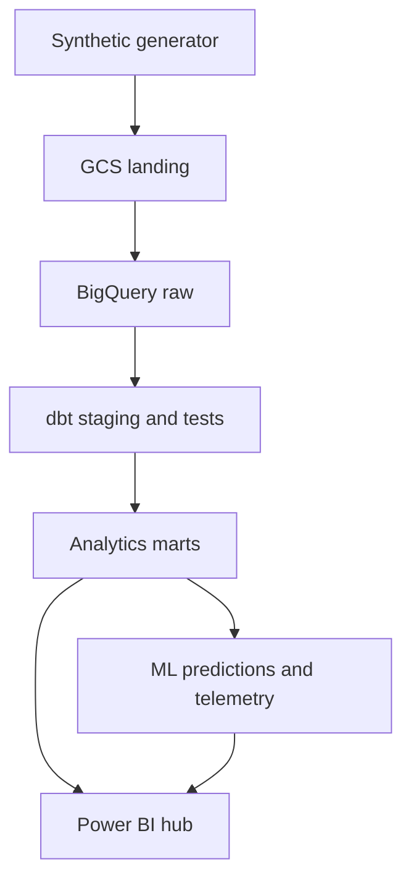

Healthcare Data Platform Capstone
A synthetic, end-to-end healthcare data system connecting cloud engineering, machine learning, and business intelligence.

This capstone follows synthetic healthcare records from raw clinical events through a tested BigQuery warehouse, predictive modeling, and a Power BI hub. The design brings together clinical outcomes, operational performance, financial measures, and pipeline health in one connected system.
Synthetic data only. Every generated record is fictional. This project does not use patient data, employer data, or proprietary information.

Project goals
- Ingest messy event records and preserve both event time and arrival time.
- Transform raw files into documented, tested, cost-aware BigQuery models with dbt.
- Demonstrate readmission and length-of-stay modeling with time-aware evaluation.
- Give clinical, operational, and financial users consistent analytics in Power BI.
- Make data quality, pipeline freshness, model behavior, and design trade-offs visible.
Current build status
Area	Implemented in this starter	Next milestone
Synthetic data	Deterministic generator for patients, encounters, clinical events, and claims; anomaly manifest; contract tests	Expand scenarios and add ingestion-run telemetry
Cloud engineering	Terraform scaffold for GCS, BigQuery datasets, and a dedicated pipeline identity; GCS-to-BigQuery loader	Review and apply in a GCP project; validate loaded tables
Warehouse	dbt source definitions, typed staging models, event deduplication, patient dimension, and encounter operations mart	Run dbt in BigQuery and expand quality tests and dimensional marts
Machine learning	Not built yet	Add leakage-aware readmission and length-of-stay models
BI	Not built yet	Build Power BI pages for clinical outcomes, patient flow, revenue cycle, and pipeline health

The local generator and its tests are runnable now. Cloud resources have not been provisioned, and the dbt models have not yet been executed against BigQuery. Model training and Power BI are later phases.
Architecture

Domains in the source data
Domain	Example data
Clinical	Encounter, diagnosis group, disposition, and event type
Operational	Facility, service line, event sequence, late arrival, and event completeness
Financial	Payer, billed amount, allowed amount, paid amount, claim status, and denial reason
Platform	Generated-data manifest today; ingestion, dbt, and model telemetry in later phases

Run locally
Requires Python 3.10 or later. The generator uses only the Python standard library.
python -m pip install -e .
python -m healthcare_capstone.cli generate --output data/generated --patients 500 --seed 42
This creates:
- patients.csv
- encounters.csv
- clinical_events.csv
- claims.csv
- data_quality_manifest.json
The event stream deliberately includes missing event timestamps, blank department values, late arrivals, out-of-order rows, and replayed source keys. The manifest reports expected anomalies separately from unexpected failures. Generated output is excluded from Git by .gitignore.

Run the contract tests from the project root:
python -m unittest discover -s tests -v
Optional GCP ingestion
The cloud path requires a GCP project, billing, Terraform, and credentials with permission to apply the reviewed plan and load BigQuery data. See [`docs/cloud-setup.md`](docs/cloud-setup.md) before provisioning anything. The Terraform files are a scaffold and have not been applied.

After provisioning the bucket and datasets, install the optional client libraries and authenticate with Application Default Credentials:
python -m pip install -r requirements-gcp.txt
export GCP_PROJECT_ID="your-gcp-project-id"
export DBT_RAW_DATASET="healthcare_capstone_raw"
python -m healthcare_capstone.cli ingest-gcp \
  --project-id "$GCP_PROJECT_ID" \
  --bucket "your-terraform-output-bucket" \
  --dataset "$DBT_RAW_DATASET"
The loader requires a manifest marked synthetic_only=true, stores each input batch under a run-specific GCS prefix, loads the raw tables with explicit string schemas, and checks loaded row counts against the manifest. Each accepted run replaces the current raw-table snapshot; this is a portfolio demonstration, not a production multi-tenant ingestion service.
Repository map
src/healthcare_capstone/   synthetic generator and optional GCP ingestion
tests/                     source-data and anomaly contract tests
infra/terraform/           GCP bucket, BigQuery datasets, and service account
warehouse/                 dbt configuration, staging, intermediate, and marts
docs/                      architecture, cloud setup, data contract, decisions
Engineering principles
- Preserve raw evidence: retain source keys and original event/arrival times so anomalies can be measured and modeled.
- Make quality visible: designed defects are counted and surfaced in curated output instead of silently discarded.
- Prevent leakage: model features must use only information available at prediction time; synthetic outcomes are not clinical evidence.
- Control cost intentionally: partition and cluster tables around documented grains and common filters, then check query behavior.
- Use least privilege: the Terraform scaffold grants the pipeline identity access to the capstone datasets and landing bucket rather than broad project-wide data access.
Documentation
- [`docs/architecture.md`](docs/architecture.md) — platform flow and trust boundaries
- [`docs/data-contract.md`](docs/data-contract.md) — table grains, keys, and intentional edge cases
- [`docs/decisions.md`](docs/decisions.md) — initial engineering trade-offs
- [`docs/cloud-setup.md`](docs/cloud-setup.md) — GCP prerequisites and plan-first setup
