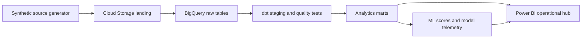

# Initial architecture

## Flow

## Initial source domains

- **Clinical:** encounter, diagnosis group, disposition, and clinical event log.
- **Operational:** facility, service line, department, event timing, and arrival delay.
- **Financial:** payer, billed, allowed, paid, claim status, and denial reason.
- **Platform telemetry:** generated-data manifest now; ingestion and dbt run metrics will be added with the pipeline.

## Trust boundaries

Every generated record is synthetic and marked `synthetic=true`. Clinical event rows intentionally include defects for engineering demonstrations; curated models must make these defects visible rather than silently hiding them. The readmission target is synthetic and must not be presented as a clinically validated model.
